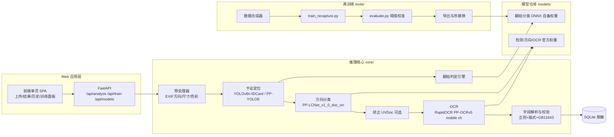

# 居民身份证翻拍识别工具 — 详细开发计划

| 项目 | 内容 |
| --- | --- |
| 文档版本 | v1.0（计划评审稿） |
| 日期 | 2026-11-12 |
| 目标仓库 | `261112_reshoot_check`（本目录） |
| 文档性质 | 详细开发计划（调研结论 + 技术方案 + 实施路线图） |

---

## 1. 项目概述

### 1.1 背景与目标

在远程开户、在线政务、实名核验等场景中，攻击者常使用**屏幕翻拍**（对手机/显示器中显示的身份证照片再拍照）或**打印翻拍**（对打印件/复印件拍照）来绕过“实拍原件”校验。本项目要构建一个**居民身份证翻拍识别工具**：

1. 输入一张含有居民身份证的照片（本地 Web 上传）；
2. 自动完成**卡证定位 → 翻拍判定（原件实拍 / 屏幕翻拍 / 打印翻拍）→ 关键字段 OCR → 结构化输出与风险报告**；
3. 以 **Web App 形式开箱即用**，仅依赖 **CPU** 推理；
4. 全部模型**随仓库发布**（官方预训练权重 + 仓库自备的翻拍分类基线权重）；
5. 提供**再训练能力**：用户对标注好的新图片可以一键微调翻拍分类器（及可选微调卡证检测、OCR），优化模型输出后热替换上线。

### 1.2 识别对象与判定口径

- **识别对象**：中华人民共和国第二代居民身份证（含国徽面/人像面；本项目默认处理人像面信息面，国徽面仅做存在性判定）。
- **判定口径**（三级）：
  - `original` 原件实拍：对实体卡片直接拍摄；
  - `screen_recapture` 屏幕翻拍：对显示身份证图像的屏幕（手机/显示器）再拍摄；
  - `print_recapture` 打印翻拍：对打印件、复印件、彩色打印件拍摄。
- 输出：`recapture_score ∈ [0,1]` + 类别 + 风险等级（低/中/高）+ 可解释线索（摩尔纹、屏幕边框、高光、纹理退化等）。

### 1.3 硬性约束

| 约束 | 要求 |
| --- | --- |
| 开发语言 | Python（3.10+） |
| 技术路线 | 机器学习，尽量复用现成/预训练模型，模型文件包含在仓库内 |
| 部署环境 | 仅 CPU（无 GPU 依赖），Windows/Linux 均可 |
| 交付形态 | 开箱即用的 Web 应用；模型训练已完成（随仓库提供可用权重） |
| 迭代能力 | 标注数据 → 再训练 → 导出 → 热替换 的完整闭环 |

---

## 2. 需求清单

### 2.1 功能需求（FR）

| 编号 | 需求 | 说明 | 优先级 |
| --- | --- | --- | --- |
| FR-01 | 图片上传 | Web 拖拽/选择，支持 JPG/PNG/BMP/WebP/HEIC(转码) | P0 |
| FR-02 | 卡证定位 | 自动检测身份证四角/包围框，支持多卡场景取最大置信度卡 | P0 |
| FR-03 | 翻拍判定 | 输出三类概率 + 分数 + 风险等级 | P0 |
| FR-04 | 可解释线索 | 输出摩尔纹/屏幕边框/高光等证据项及对应得分 | P0 |
| FR-05 | 关键字段 OCR | 姓名、性别、民族、出生、住址、公民身份号码、签发机关、有效期 | P0 |
| FR-06 | 字段校验 | 18 位公民身份号码校验位（GB 11643-1999）、日期/性别一致性 | P1 |
| FR-07 | 结果可视化 | 标注卡框、风险等级、字段高亮；支持导出 JSON | P1 |
| FR-08 | 批量处理 | 多图队列，进度显示 | P1 |
| FR-09 | 历史记录 | 本地 SQLite 记录（脱敏），可检索、复核 | P1 |
| FR-10 | 误判反馈 | 用户可标记“判错”，样本进入人工复核/再训练队列 | P1 |
| FR-11 | 再训练入口 | CLI/页面触发：标注目录 → 训练 → 评估 → 导出 ONNX → 热替换 | P0 |
| FR-12 | 模型管理 | 查看模型版本、指标、回滚 | P2 |

### 2.2 非功能需求（NFR）

| 编号 | 需求 | 指标（目标值） |
| --- | --- | --- |
| NFR-01 | 仅 CPU 运行 | 4 核 CPU 端到端 ≤ 3 s/图（P95），内存 ≤ 2.5 GB |
| NFR-02 | 开箱即用 | 安装依赖后一条命令启动，首次自动补齐模型，无人工配置 |
| NFR-03 | 模型随仓库 | 模型以 Git LFS/引导下载器方式入库，带 SHA256 校验 |
| NFR-04 | 隐私合规 | 默认不落盘原图（可配置）；日志与库中身份证号打码；提供合规声明 |
| NFR-05 | 可移植 | Windows 10/11 与主流 Linux 发行版；Python 3.10+ |
| NFR-06 | 可测试 | 提供评估脚本、基准测试集、指标复现说明 |

---

## 3. 前沿资料调研综述

> 本节结论基于 2026-11 的公开资料检索，全部链接见[第 13 节参考资料](#13-参考资料)。

### 3.1 学术前沿：翻拍/屏幕重拍检测

| 论文/工作 | 核心方法与结论 | 对本项目的启示 |
| --- | --- | --- |
| **CMA: A Chromaticity Map Adapter for Robust Detection of Screen-Recapture Document Images**（CVPR 2024，[链接](https://openaccess.thecvf.com/content/CVPR2024/html/Chen_CMA_A_Chromaticity_Map_Adapter_for_Robust_Detection_of_Screen-Recapture_CVPR_2024_paper.html)） | 提出像素级屏幕翻拍失真模型；提取**色度图（chromaticity map）**作为多模态 prompt 接入 Transformer；自建 10K+ 办公文档翻拍数据集；平均 EER 26.82%→16.78%，JPEG QF=70 下 AUC 0.8688、534×503 低分辨率下 AUC 0.7554 | ①色度/颜色伪影是经 OSN 压缩后仍健壮的线索；②Transformer 方案重，本项目采用“轻量 CNN 分类 + 信号分析”折中，色度图作为特征工程输入之一 |
| **Disentangling Moiré and Texture: Towards Robust Display-Recapture Detection for Document Images**（IEEE，2025，[链接](https://ieeexplore.ieee.org/abstract/document/11458572)） | 将摩尔纹与文档固有纹理解耦，提升显示翻拍检测在纹理密集文档上的鲁棒性 | 身份证存在网纹/底纹，须防“真纹理误报为摩尔纹”；信号分支需频域+空域联合并做区域掩码 |
| **Display-Recaptured Document Image Detection Under Texture Interference**（IEEE，2025，[链接](https://ieeexplore.ieee.org/iel8/8782710/9006934/11673094.pdf)） | 针对纹理干扰的显示翻拍检测，提供即插即用模块 | 可作为分类器前置插件（备选方案，不列入 v1.0） |
| **Recaptured screen image identification based on vision transformer**（JVCIR 2022，[链接](https://dl.acm.org/doi/10.1016/j.jvcir.2022.103692)） | ViT 对屏幕翻拍的全局伪影建模优于局部卷积线索 | 印证“整卡 + 局部 patch 双尺度输入”设计 |
| **Recaptured Raw Screen Image and Video Demoiréing via Channel and Spatial Modulations (VD_raw)**（NeurIPS 2023，[链接](https://github.com/ailabteam/VD_raw)） | 翻拍原始域去摩尔纹 | 其思路可用于**数据合成**（生成带真实感摩尔纹的翻拍样本）与线索可视化 |
| **Chimera: Creating Digitally Signed Fake Photos by Fooling Image Recapture and Deepfake Detectors**（USENIX Security 2025，[链接](https://secartifacts.github.io/usenixsec2025/appendix-files/sec25cycle1ae-final147.pdf)） | 定向对抗可同时绕过翻拍检测与深伪检测 | 提示需做基本对抗鲁棒性测试（轻微扰动/压缩下的指标），并在文档中声明能力边界 |
| **PP-LCNet: A Lightweight CPU Convolutional Neural Network**（arXiv 2109.15099，[链接](https://arxiv.org/abs/2109.15099)） | 面向 CPU 的轻量骨干，深度可分离卷积 + SE 等 | 翻拍分类器首选骨干（PP-LCNet_x1_0，约 7 MB） |
| 中文专利/学位论文：基于 LBP 水印特征与细粒度识别的图像翻拍检测（CN202010628464.2，[链接](https://d.wanfangdata.com.cn/patent/CN202010628464.2)）；《面向翻拍文档取证的图像低层失真研究》 | 国内已有“低层失真特征 + 细粒度分类”的翻拍取证先例 | 印证本项目“信号特征 + 深度学习”双分支路线的合理性 |

**学术侧小结**：翻拍检测的核心线索是**摩尔纹、屏幕栅格/色偏、色度伪影、纹理退化、边框与高光**；纯频域（FFT）特征对高质量专业翻拍失效，**RGB 空域 + 轻量 CNN 的迁移学习是性价比最高的基线**（见 3.3 社区实证），色度图是值得吸收的前沿增强。

### 3.2 工业界现成模型与工具

| 模块 | 现成模型/工具 | 关键指标（官方口径） | 引用 |
| --- | --- | --- | --- |
| 文档方向分类 | PP-LCNet_x1_0_doc_ori | 7 MB；Top-1 99.06%；CPU 3.24 ms（常规）/1.19 ms（高性能） | [文档预处理产线文档](https://raw.githubusercontent.com/PaddlePaddle/PaddleOCR/5711acc40a78e9134c8fadc028672bcc650b2653/docs/version3.x/pipeline_usage/doc_preprocessor.md) |
| 形变矫正 | UVDoc | 30.3 MB；DocUNet CER 0.179；CPU 869.82 ms（高性能模式） | 同上 |
| 中文 OCR | **PP-OCRv5**（mobile/server） | 印刷中文识别 mobile 0.8605 / server 0.9013；CPU 端到端 v5_mobile ≈1.14 s/图（高性能推理，Xeon Gold 6271C 8 线程） | [PP-OCRv5 简介](http://www.paddleocr.ai/v3.0.2/version3.x/algorithm/PP-OCRv5/PP-OCRv5.html) |
| 最新 OCR | **PP-OCRv6**（tiny/small/medium，PPLCNetV4 骨干） | 1.5M–34.5M 参数三档；medium：检测 Hmean 86.2%、识别 83.2%，50 语言；tiny/small 面向端侧与移动/桌面，适合 CPU | [PP-OCRv6 简介](https://www.paddleocr.ai/latest/version3.x/algorithm/PP-OCRv6/PP-OCRv6.html) |
| OCR 轻量运行时 | **RapidOCR**（rapidocr，ONNX Runtime 引擎） | 集成 PP-OCRv4/v5 中文检测/识别 ONNX 模型，模型托管 ModelScope、自动下载，pip 即装即用 | [RapidOCR 模型列表](https://rapidai.github.io/RapidOCRDocs/v3.8.3/model_list/) |
| 卡证检测 | PaddleX 通用目标检测（PP-YOLOE 系）+ Ultralytics **YOLOv8n** | YOLOv8n 约 3.2M 参数、CPU 可达数十毫秒/图；有公开身份证检测数据集可直接微调 | [Roboflow id-card 数据集](https://universe.roboflow.com/id-card-1clqf/id-card-detecter-slgot/dataset/8)；[PaddleOCR 场景应用（卡证类 OCR）](http://www.paddleocr.ai/v2.9/applications/overview.html) |
| 分类训练框架 | PaddleClas（PP-LCNet/PP-HGNet，一键微调+导出） | 官方长期维护的国产分类框架，CPU 推理友好 | [PaddleClas](https://github.com/PaddlePaddle/PaddleClas) |
| CPU 推理引擎 | ONNX Runtime（可选 OpenVINO EP）、Paddle Inference、RapidOCR 支持的 openvino/paddle 引擎 | 均纯 CPU 可用 | [PaddleOCR 高性能推理指南](https://www.paddleocr.ai/latest/version3.x/inference_deployment/local_inference/high_performance_inference.html) |
| 翻拍检测参考实现 | `7skaliahmed07/recapture-image-detection-thesis_Unina-RUG` | 13 组实验：**RGB-EfficientNetB0 92%（F1 0.92）**为最佳；RGB+Laplacian 双输入 90%；MobileNetV3 89%；**纯 FFT 特征仅 50%（失效）**；含 HF Space 在线 demo（权重可获取） | [项目主页](https://github.com/7skaliahmed07/recapture-image-detection-thesis_Unina-RUG)；[在线 demo](https://huggingface.co/spaces/UzerDeveloper07/screen-recapture-detection) |
| 翻拍检测参考实现 | `fernandafica/single_capture_and_recaptured_image_classification` | 单次拍摄 vs 翻拍二分类参考实现 | [GitHub](https://github.com/fernandafica/single_capture_and_recaptured_image_classification) |
| 卡证多角度检测参考 | `xuehaisj/id_card_multi_angle_detection` | 身份证多角度检测项目（含数据集说明） | [AtomGit](https://atomgit.com/xuehaisj/id_card_multi_angle_detection) |
| 离线 OCR 引擎参考 | OnnxOCR | 纯 ONNX 的多语言 OCR 引擎（可作自研替代的参考） | [AtomGit](https://atomgit.com/OnnxOCR/OnnxOCR/tree/OCR-skill) |

### 3.3 公开数据集

| 数据集 | 内容 | 用途 | 引用 |
| --- | --- | --- | --- |
| Roboflow `id-card-detecter` | 身份证检测框标注（YOLO v8 格式） | 卡证定位检测微调 | [链接](https://universe.roboflow.com/id-card-1clqf/id-card-detecter-slgot/dataset/8) |
| AxonData `Selfie_and_Official_ID_Photo_Dataset` | 自拍+官方证件照数据集（HF，cc-by-nc-nd-4.0） | 人像相关负样本/数据补充（注意许可） | [链接](https://huggingface.co/datasets/AxonData/Selfie_and_Official_ID_Photo_Dataset) |
| Zenodo `Caught on Camera (CoC) Dataset v1.0` | 屏幕拍摄场景检测数据 | 屏幕翻拍场景研究参考 | [链接](https://zenodo.org/records/23150212) |
| 论文伴随数据集（NTU DSLR/Android 等，见 3.1 社区项目） | 原件/翻拍配对样本 | 翻拍分类器训练底座（**需逐一核实再分发许可，未授权数据仅用于训练不随仓库分发**） | 见 [7skaliahmed07 项目](https://github.com/7skaliahmed07/recapture-image-detection-thesis_Unina-RUG) |
| 自采集 + 合成数据（本项目） | 自己拍摄原件/屏幕翻拍/打印翻拍 + 程序化仿真（见 6.3） | **随仓库发布或随发布说明提供的训练底座**，规避版权风险 | 见 §6 |

> 说明：CMA（CVPR 2024）的 10K 翻拍数据集未见官方公开下载，不作为训练底座；方案以“公开可再分发数据 + 自采集 + 合成仿真”保证合规。

### 3.4 调研结论（指导选型）

1. **“翻拍分类”没有一家独大的官方预训练权重**：PaddleOCR/PaddleX/Hugging Face 均无权威“身份证翻拍检测”成品权重；工程上最成熟、成本最低的路线是：**官方预训练骨干（EfficientNet-B0 / PP-LCNet_x1_0）+ 仓库自备微调权重 + 一键再训练脚本**。这与用户“模型训练已完成、尽量现成模型、可再训练”的要求完全匹配。
2. **除翻拍分类外，其余环节全部有成熟官方模型**：方向分类、UVDoc 矫正、PP-OCRv5/v6 中文 OCR、PP-YOLOE/YOLOv8 卡证检测，均以预训练权重形态随仓库分发或自动下载。
3. **CPU 可行性**：所有选型均为移动端/轻量档；官方 CPU 基准（PP-OCRv5_mobile 高性能推理 1.14 s/图，方向分类 3.24 ms）表明在 4 核 CPU 上可满足 ≤3 s/图目标，卡面裁剪后 OCR 输入更小、耗时进一步下降。
4. **翻拍线索必须“双分支”**：纯 CNN 可解释性差、纯频域对高质量翻拍失效；采用 **信号分析分支（可解释证据）+ 深度分类分支（端到端判别）** 加权融合，并吸收 CMA 的色度图与“摩尔纹 vs 底纹解耦”思想。

---

## 4. 总体技术方案

### 4.1 架构



### 4.2 推理流水线（详细）

| 步骤 | 名称 | 处理内容 | 模型/算法 | 兜底策略 |
| --- | --- | --- | --- | --- |
| 1 | 输入归一化 | 解码（含 HEIC）、EXIF 方向纠正、长边缩至 ≤1600、保存原图仅存内存 | OpenCV/Pillow | 解码失败返回错误码 |
| 2 | 卡证定位 | 检测身份证区域，输出旋转框 + 四点 | YOLOv8n-IDCard（自微调，ONNX）/ PP-YOLOE 卡证权重 | 未检出 → 轮廓+边缘启发式二次尝试；仍失败返回“未检测到身份证” |
| 3 | 裁剪与双尺度 | 卡面透视矫正出 856×540 基准图；另取原始卡域与四周留白区域 | cv2.getPerspectiveTransform | 矫正失败用轴对齐裁剪 |
| 4 | 翻拍判定 | **双分支**（见 4.3）：信号分析 + 深度分类，输出分数与线索 | 分类器（EfficientNet-B0 或 PP-LCNet_x1_0，3 类） | 分类不可用（权重缺失）时仅信号分支并标注低置信 |
| 5 | 方向分类 | 0/90/180/270 | PP-LCNet_x1_0_doc_ori（7 MB） | 未启用时跳过 |
| 6 | 形变矫正（可选） | 褶皱/弧面/透视残差矫正 | UVDoc（30.3 MB，CPU ~0.87 s，默认关闭可配置） | 跳过不影响主流程 |
| 7 | OCR | 文本行检测+识别 | RapidOCR：PP-OCRv5 mobile（ch，det+rec，ONNX） | 失败时降级 PP-OCRv4 mobile |
| 8 | 字段解析校验 | 按版式与正则抽取 8 类字段；校验位/生日性别一致性；输出 JSON | 规则引擎（附录 A） | 置信度低字段标 `low_confidence` |

### 4.3 翻拍判定双分支设计（核心）

**分支 A：可解释信号分析（规则+经典图像处理，无训练依赖）**

| 线索 | 检测方法 | 说明 |
| --- | --- | --- |
| 摩尔纹 | 2D FFT 频谱峰值检测（径向/方向能量），叠加“底纹掩码”抑制身份证固有网纹（借鉴《Disentangling Moiré and Texture》） | 屏幕翻拍强线索；低分辨率/强压缩下衰减 |
| 屏幕栅格/色偏 | 局部颜色周期性分析 + 色度图统计（借鉴 CMA） | 液晶像素阵列、蓝移/色域异常 |
| 屏幕边框/黑边 | 卡域四周亮度极低连通域、规则矩形边缘 | 翻拍屏幕照片常见 |
| 高光/反射 | 亮度直方图高位截断 + 高光连通域形态 | 玻璃屏幕反射特征 |
| 纹理退化 | 高频能量比（Laplacian 方差/能量）、清晰度 | 打印翻拍纹理损失显著 |
| 打印件特征 | 纸面纹理、网点（半色调）频率检测、色彩饱和度下降 | 打印/复印翻拍 |
| 元信息 | EXIF 相机信息缺失/异常、图像来源软件特征 | 弱线索，仅参与加权 |

每项输出归一化得分与证据描述（如“检测到 45° 方向摩尔纹峰值”）。

**分支 B：深度分类**

- 输入：卡面基准图（856×540）+ 原始卡域 patch（多尺度，借鉴 JVCIR ViT 全局伪影结论）；可选附加色度图通道（CMA 思想，作为 v1.1 增强）。
- 骨干：**EfficientNet-B0（ImageNet 预训练，社区实证最佳）** 或 **PP-LCNet_x1_0（国产、CPU 友好）**，3 类 softmax。
- 权重来源：v1.0 随仓库发布（在“公开可再分发数据 + 自采集 + 合成仿真”上微调完成的基线权重），指标在 `models/recapture/METRICS.md` 公开。

**融合与分级**

```
recapture_score = w1 * P(screen|CNN) + w2 * P(print|CNN) + w3 * signal_score
signal_score   = Σ(规则分 * 权重)（在验证集上以逻辑回归拟合最优权重）
风险分级：score < 0.30 → 低风险(原件)；0.30–0.60 → 中风险(建议人工复核)；> 0.60 → 高风险(疑似翻拍)
阈值在 evaluate.py 中按“目标 FPR（默认 5%）”自动校准，阈值/权重均存配置文件。
```

### 4.4 技术选型总表

| 层 | 选型 | 理由 |
| --- | --- | --- |
| 语言/环境 | Python 3.10+；venv + pip | 要求 Python |
| Web 后端 | FastAPI + Uvicorn | 轻量、异步、自动文档 |
| 前端 | 静态单页（原生 JS + 轻量样式，或 Vue3+Vite 编译产物随仓库发布） | 开箱即用、无 Node 运行依赖 |
| 推理引擎 | ONNX Runtime CPU（可选 OpenVINO EP）；OCR 走 RapidOCR（onnxruntime/openvino 引擎） | 全 CPU、跨平台、体积可控 |
| 图像处理 | OpenCV-Python、Pillow、NumPy | 通用 |
| 检测 | Ultralytics（训练/导出）→ YOLOv8n ONNX；备选 PaddleX PP-YOLOE 卡证权重 | 生态成熟、CPU 快 |
| 分类训练 | 主：PyTorch + timm（EfficientNet）；备：PaddleClas（PP-LCNet，含国产训练生态） | 训练简单、导出 ONNX 一致 |
| OCR | rapidocr（PP-OCRv5 mobile ch，det+rec，ONNX 自动下载/可离线内置） | 官方模型 + 极简接入 |
| 存储 | SQLite（记录与复核队列，敏感字段脱敏） | 零运维 |
| 任务队列 | 进程内 ThreadPool + 简单队列（批量处理） | 避免引入重型中间件 |

---

## 5. 模型仓库与“开箱即用”策略

### 5.1 模型清单（v1.0 随仓库发布）

| 模型 | 用途 | 来源 | 近似体积 | 托管方式 |
| --- | --- | --- | --- | --- |
| `yolov8n_idcard.onnx` | 卡证定位 | ultralytics 预训练 + Roboflow/自采数据微调（本项目训练完成） | ~6 MB | 直接入库 |
| `recap_effb0.onnx`（或 `recap_pplcnet.onnx`） | 翻拍三分类 | 官方骨干预训练 + 本项目微调（**v1.0 即随仓库发布可用权重，训练已完成**） | ~17 MB / 7 MB | 直接入库 |
| `PP-LCNet_x1_0_doc_ori` 方向分类 | 方向分类 | PaddleX 官方 | 7 MB | 直接入库 |
| `UVDoc`（可选） | 形变矫正 | PaddleX 官方 | 30.3 MB | 直接入库 |
| PP-OCRv5 mobile ch det/rec（ONNX） | OCR | PaddleOCR 官方 → RapidOCR 转换版 | ~20 MB | 直接入库（优先）+ ModelScope 兜底下载 |
| 配置文件 | 阈值/融合权重/字段模板 | 本项目 | — | 直接入库 |

### 5.2 托管与校验策略

- 仓库使用 **Git LFS** 管理 `models/` 下二进制（<100 MB 单文件），`.gitattributes` 覆盖 `*.onnx *.pdparams *.pt`；
- `scripts/bootstrap_models.py`：首次启动自动检查 `models/` 完整性（**SHA256 校验清单 `models/checksums.json`**），缺失文件从内置镜像 URL 下载（主源 + 国内镜像 ModelScope/HF 镜像 + 官方源三级回退），支持 `--offline` 跳过；
- 发布物附带 `dist/` 离线包：`whl 依赖 + models 打包`，供完全离线内网环境使用；
- 模型版本号 `models/recapture/VERSION` 与 `METRICS.md`（训练集构成、AUC/EER/Acc/混淆矩阵）同步维护。

### 5.3 一键启动（开箱即用）

```bash
# Windows
setup.bat      # 创建 venv、安装 requirements（清华/阿里镜像）、运行 bootstrap_models.py
run.bat        # 启动服务并自动打开 http://127.0.0.1:8000

# Linux
./setup.sh && ./run.sh
```

服务启动即加载全部模型（热加载约 1–3 s），无任何人工配置步骤。

---

## 6. 数据体系与再训练能力（重点需求）

### 6.1 数据目录规范

```
data/
├── raw/                      # 原始素材（不进 Git）
├── recapture/                # 翻拍分类数据（三分类文件夹式，LabelMe/CLS 两种格式均接受）
│   ├── original/
│   ├── screen_recapture/
│   └── print_recapture/
├── idcard_det/               # 卡证检测数据（YOLO 格式：images + labels）
├── synthetic/                # 合成仿真产物（脚本生成，可复现）
└── feedback/                 # Web 端误判反馈队列（自动归类，等待人工复核）
```

### 6.2 标注规范与工具

- 分类：按目录归类即可（`data/recapture/<class>/`），可选 LabelMe 多边形裁剪出卡域；
- 检测：X-AnyLabeling / LabelImg（YOLO 矩形，类别 `idcard`）；
- 提供 `tools/convert_labels.py`：LabelMe→CLS 目录、LabelMe→YOLO 转换；
- 复核队列：`feedback/` 下图片由人工在 Web“复核”页一键确认标签后并入 `data/recapture/`。

### 6.3 数据合成与增强（保证“开箱即有训练底座”）

`tools/synthesize.py` 支持从任意身份证图/通用文档图程序化生成翻拍样本：

| 仿真类型 | 操作 |
| --- | --- |
| 屏幕翻拍 | 摩尔纹合成（多方向/多频率正弦+乘法叠加，参考 VD_raw 思路）、屏幕栅格、亮度/对比度衰减、色温偏移（蓝移）、轻微透视、高斯模糊、JPEG 重压缩（模拟 OSN） |
| 打印翻拍 | 半色调网点模拟、纸面噪声、饱和度下降、扫描亮度曲线、模糊+重压缩 |
| 通用增强 | 随机裁剪/旋转/透视、光照变化、色彩抖动、MixUp/CutMix（训练期） |

合成样本用于：①v1.0 基线权重训练；②每次再训练的数据扩充（可配置混合比例）。

### 6.4 翻拍分类再训练（核心闭环）

`tools/train_recapture.py`（PyTorch + timm，等价 PaddleClas 命令见注释）：

```bash
# 1) 训练（CPU/GPU 均可；小数据集 CPU 亦可用）
python tools/train_recapture.py --data data/recapture \
    --backbone efficientnet_b0 --epochs 30 --img-size 300 \
    --out runs/recap_v1.1 --cpu

# 2) 评估 + 阈值校准（输出 AUC/EER/Acc/F1/混淆矩阵，按目标 FPR 校准阈值写入 config）
python tools/evaluate.py --ckpt runs/recap_v1.1/best.pt \
    --data data/recapture --target-fpr 0.05 --save-config

# 3) 导出 ONNX 并热替换（自动备份旧版本、更新 METRICS.md）
python tools/export_and_swap.py --ckpt runs/recap_v1.1/best.pt
```

- 支持 **增量/继续训练**（`--resume`）、类别权重（`--class-weights` 应对样本不均衡）、早停；
- 训练产物：`best.pt` → `best.onnx`（动态/固定 shape 双版本）→ 复制到 `models/recapture/` 并更新 `VERSION`；
- **A/B 回滚**：`models/recapture/versions/<v>/` 保留最近 3 版，Web“模型管理”页可一键回滚；
- 训练日志与指标以 MLflow 风格目录（`runs/<name>/metrics.json`）落盘。

### 6.5 卡证检测与 OCR 再训练（可选能力）

| 对象 | 方式 | 入口 |
| --- | --- | --- |
| 卡证检测 | ultralytics：`yolo train model=yolov8n.pt data=data/idcard_det/data.yaml`；训练后 `yolo export format=onnx` | CLI + 文档示例 |
| OCR det/rec | PaddleOCR/PaddleX 官方微调教程（文本检测/识别模块均支持自定义数据集微调后无缝接入） | [文本检测模块](https://www.paddleocr.ai/latest/version3.x/module_usage/text_detection.html) / [文本识别模块](https://www.paddleocr.ai/latest/version3.x/module_usage/text_recognition.html)；导出 ONNX 后替换 rapidocr 模型路径 |
| 字段解析 | 纯规则（config/fields.yaml 模板），无需训练 | — |

### 6.6 在线反馈闭环（Web → 再训练）

1. 用户对结果点击“判错”并选择真实类别 → 原图（卡域裁剪，脱敏可选）进入 `data/feedback/`；
2. 复核页人工确认标签 → 移入 `data/recapture/<class>/`；
3. 达到阈值数量（默认 50 张）时 Web 提示可再训练；
4. 执行 6.4 流程完成新权重上线，全程不中断服务（推理进程热加载新 ONNX）。

---

## 7. Web 应用设计

### 7.1 页面

| 页面 | 功能 |
| --- | --- |
| 首页（识别） | 拖拽上传/拍照上传；实时展示：卡框标注图、风险等级（绿/黄/红）、三类概率条、可解释线索列表、字段表格（敏感字段默认打码，可点击显隐） |
| 批量 | 多文件队列、进度条、结果总览表、导出 CSV/JSON |
| 历史 | 检索、详情回看、误判反馈按钮 |
| 复核 | 反馈队列确认标签 |
| 模型 | 当前版本/指标/回滚；再训练参数表单（数据目录、轮数、骨干）触发训练任务 |
| 设置 | 阈值、融合权重、隐私开关（是否落盘原图）、日志级别 |

### 7.2 API 设计（节选）

| 方法 | 路径 | 说明 |
| --- | --- | --- |
| POST | `/api/analyze` | multipart 上传 1 图，同步返回完整结果 |
| POST | `/api/batch` | 多图，返回 task_id |
| GET | `/api/batch/{task_id}` | 轮询进度与结果 |
| POST | `/api/feedback` | 提交误判反馈 |
| POST | `/api/train` | 触发再训练（异步，参数同 6.4） |
| GET | `/api/train/{job_id}` | 训练进度（loss/轮次） |
| GET | `/api/models` | 模型版本与指标 |
| POST | `/api/models/rollback` | 回滚模型版本 |

`/api/analyze` 响应示例（节选）：

```json
{
  "code": 0,
  "result": {
    "card_bbox": [[x1,y1],[x2,y2],[x3,y3],[x4,y4]],
    "recapture": {
      "score": 0.86,
      "risk": "high",
      "class": "screen_recapture",
      "probs": {"original": 0.08, "screen_recapture": 0.85, "print_recapture": 0.07},
      "evidences": [
        {"name": "moire", "score": 0.72, "detail": "检测到约 45° 方向摩尔纹峰值"},
        {"name": "screen_bezel", "score": 0.55, "detail": "卡域右侧存在屏幕黑边"}
      ]
    },
    "fields": {
      "name": "张*", "gender": "男", "ethnicity": "汉",
      "birth": "19**年*月**日", "address": "北京市***（打码）",
      "id_number": "110101********1234",
      "authority": "北京市公安局***分局", "valid_period": "2020.01.01-2040.01.01",
      "id_checksum_valid": true
    },
    "confidence": {"ocr": 0.97, "recapture": 0.88}
  }
}
```

### 7.3 隐私与合规

- 全流程本地推理，无云端调用；原图默认仅驻留内存（配置可改为不落盘）；反馈样本可配置“仅存卡域裁剪+掩码版”；
- 身份证号、姓名默认打码展示/落库，可配置关闭记录；
- 界面与文档显著声明：仅用于授权业务场景（如自有证件核验、内部质检），不对第三方人脸/身份数据做未授权采集，使用方需遵守《个人信息保护法》等相关法规。

---

## 8. 项目目录结构

```text
261112_reshoot_check/
├── 身份证翻拍识别工具开发计划.md   # 本文档
├── README.md                       # 快速开始
├── setup.bat / setup.sh            # 一键安装（venv + 依赖 + 模型引导）
├── run.bat / run.sh                # 一键启动
├── requirements.txt / requirements-dev.txt
├── config/
│   ├── settings.yaml               # 阈值/融合权重/隐私开关/性能参数
│   └── fields.yaml                 # 身份证字段模板与正则
├── models/
│   ├── checksums.json              # SHA256 清单
│   ├── recapture/                  # 翻拍分类（自备权重 + VERSION + METRICS.md + versions/）
│   ├── idcard_det/
│   ├── doc_orientation/
│   ├── unwarp/                     # UVDoc（可选）
│   └── ocr/                        # PP-OCRv5 det/rec/字典
├── app/
│   ├── main.py                     # FastAPI 入口
│   ├── api/                        # 路由（analyze/batch/feedback/train/models）
│   ├── core/
│   │   ├── pipeline.py             # 流水线编排
│   │   ├── detect.py               # 卡证定位
│   │   ├── recapture/
│   │   │   ├── signals.py          # 分支A：摩尔纹/边框/高光/纹理/打印特征
│   │   │   └── classifier.py       # 分支B：CNN 推理 + 融合 + 分级
│   │   ├── ocr_engine.py           # RapidOCR 封装
│   │   └── fields.py               # 字段解析与 GB11643 校验
│   ├── services/                   # 队列、存储(脱敏)、模型版本管理
│   └── web/                        # 前端静态资源（编译产物入库）
├── tools/
│   ├── synthesize.py               # 翻拍样本合成
│   ├── convert_labels.py           # LabelMe/YOLO 转换
│   ├── train_recapture.py          # 翻拍分类训练
│   ├── evaluate.py                 # 评估 + 阈值校准
│   ├── export_and_swap.py          # ONNX 导出与热替换/回滚
│   └── bootstrap_models.py         # 模型完整性检查与下载
├── data/                           # 训练数据（.gitignore，见 6.1）
├── tests/                          # 单元/集成/回归测试
└── docs/                           # 部署、再训练、API 文档
```

---

## 9. 实施计划（里程碑）

预计单人 3.5–4 周 / 双人 2–2.5 周。所有里程碑交付物必须通过对应验收标准。

| 里程碑 | 内容 | 交付物 | 验收标准 |
| --- | --- | --- | --- |
| **M0 环境与骨架**（2 天） | 仓库骨架、依赖锁定、bootstrap_models、CI 冒烟 | 可运行空服务 + 模型下载脚本 | `run.bat` 一次通过；依赖在纯净 Windows 装成功 |
| **M1 数据与基线训练**（4 天） | 采集/合成样本≥每类 500 张；训练卡证检测与翻拍分类基线 | 两个 ONNX + METRICS.md + synthesize/convert 工具 | 自建验证集：翻拍 AUC≥0.95、卡证 mAP50≥0.97 |
| **M2 推理核心**（5 天） | 全流水线：定位→双分支翻拍→方向/矫正→OCR→字段校验 | `app/core/` 全部模块 + 单测 | 100 张端到端测试集：风险分级准确率≥90%；字段准确率≥95%（清晰原件） |
| **M3 Web 应用**（3 天） | 前端页面 + API + 历史/反馈 | 可用的 Web 应用 | 6 个页面功能走查通过；批量 20 图无内存泄漏 |
| **M4 再训练闭环**（3 天） | train/evaluate/export/热替换/回滚 + 训练面板 + 文档 | 再训练全流程 + docs | 用 200 张新标注数据完成一次全流程，新权重上线并回滚成功 |
| **M5 测试验收与发布**（2 天） | 性能压测、对抗鲁棒测试、隐私核查、打包离线发行包 | 发布包 + 验收报告 | 4 核 CPU 端到端 P95 ≤3 s；验收清单（§10.3）全绿 |

---

## 10. 测试与验收

### 10.1 指标定义

| 指标 | 定义 | 目标 |
| --- | --- | --- |
| 翻拍检测 AUC / EER | 三分类按“非原件”二值化后的 ROC | AUC ≥ 0.95（自建集） |
| 翻拍检测 Acc/F1 | 三分类加权 | F1 ≥ 0.90 |
| 高风险召回率 | 高风险判定中真实翻拍占比（固定 FPR=5% 校准） | Precision@high ≥ 0.90 |
| 卡证检测 mAP50 | 自建检测集 | ≥ 0.97 |
| 字段准确率 | 8 字段完全正确比例（清晰原件） | ≥ 95%；号码校验位 100% |
| 端到端延迟 | 上传→结果（4 核 CPU） | P95 ≤ 3 s |
| 鲁棒性 | JPEG QF=70、缩放至 600px、±10% 亮度下的翻拍 AUC 降幅 | ≤ 0.05 |

### 10.2 测试集构建（随仓库发布 `tests/data/benchmark/`）

| 分组 | 内容 | 规模建议 |
| --- | --- | --- |
| A 原件实拍 | 不同手机/光照/角度拍摄真实卡 | ≥ 200 |
| B 屏幕翻拍 | 手机/显示器/平板显示同一批卡再拍摄 | ≥ 200 |
| C 打印翻拍 | 黑白复印、彩色打印、复印件再拍 | ≥ 200 |
| D 干扰样本 | 过曝/过暗、模糊、低分辨率、遮挡、无卡 | ≥ 100 |

### 10.3 验收清单（节选）

- [ ] 纯净 Windows/Linux 环境一键安装、一键启动，无需 GPU；
- [ ] 首次启动自动补齐全部模型且 SHA256 校验通过；
- [ ] 三类翻拍场景（A/B/C）识别与风险分级符合指标；
- [ ] 敏感信息默认打码，落盘策略符合配置；
- [ ] 新标注数据可完成“训练→评估→导出→热替换→回滚”全流程；
- [ ] 断网环境（离线发行包）可完整运行；
- [ ] 提供 README、部署文档、再训练文档、模型指标说明。

---

## 11. 风险与对策

| 风险 | 影响 | 对策 |
| --- | --- | --- |
| 公开翻拍数据版权/许可不清 | 基线权重无法合规随仓库发布 | 以自采集+合成仿真为主训练底座；公开数据仅内部训练并在 METRICS 中披露构成；必要时仅发布“合成数据权重”并保留一键再训练 |
| 高质量专业翻拍/对抗攻击绕过（如 Chimera） | 漏检 | 双分支融合 + 多尺度输入；鲁棒测试进 CI；文档明确能力边界与“中风险人工复核”兜底 |
| 身份证固有网纹被误判为摩尔纹 | 原件误报 | 底纹掩码 + 空域纹理校验；在“原件”集上专项调阈值 |
| PP-OCRv5 CPU 耗时在低端机超预算 | 延迟超标 | 卡面裁剪缩小输入、关闭 UVDoc/方向分类可选项、OpenVINO EP、降级 v4 mobile；预留 PP-OCRv6 tiny 升级路径 |
| PaddleOCR/rapidocr 版本迭代接口变化 | 升级断裂 | 锁定依赖版本（requirements 固定小版本）；OCR 封装成独立接口 `ocr_engine.py` |
| 大模型文件使仓库膨胀 | 克隆/分发困难 | Git LFS + 引导下载 + 离线发行包三级策略（§5.2） |
| 敏感个人信息泄露 | 合规事故 | 默认内存处理+打码+不记录；反馈队列可选脱敏；安全自查清单入 CI |

---

## 12. 附录 A：身份证字段解析与校验要点

| 字段 | 版式要点 | 校验规则 |
| --- | --- | --- |
| 姓名 | 卡面左上（2–4 个汉字，少数含“·”） | 长度 2–15 |
| 性别 | “性别 男/女” | 与号码第 17 位奇偶一致性校验 |
| 民族 | “民族 X” | 56 民族字典（含“其他”） |
| 出生 | “出生 YYYY 年 MM 月 DD 日” | 合法日期；与号码 7–14 位一致 |
| 住址 | 最长字段，常跨 2–3 行 | 行拼接 + 首行关键词锚定 |
| 公民身份号码 | 18 位，版式固定 | **GB 11643-1999 校验位**（加权因子 mod 11，含“X”）；与出生/性别交叉校验 |
| 签发机关 | “签发机关 X” | 文本非空 |
| 有效期限 | “有效期限 YYYY.MM.DD-YYYY.MM.DD / 长期” | 日期合法性；长期=65 周岁以上逻辑提示 |

## 13. 附录 B：依赖清单（requirements.txt 初稿）

```text
numpy<3
opencv-python-headless
pillow
onnxruntime>=1.17        # 可选 onnxruntime-openvino 提速
rapidocr>=3.3            # OCR（PP-OCRv5 ch mobile）
fastapi
uvicorn[standard]
python-multipart
pydantic>=2
pyyaml
# --- 训练/再训练（可放入 requirements-dev.txt 或 extras） ---
torch (CPU 版)
timm
ultralytics
# --- 可选 ---
paddleocr / paddlex      # OCR 微调路线（全飞桨方案）
```

---

## 14. 参考资料

1. Chen et al., *CMA: A Chromaticity Map Adapter for Robust Detection of Screen-Recapture Document Images*, CVPR 2024 — https://openaccess.thecvf.com/content/CVPR2024/html/Chen_CMA_A_Chromaticity_Map_Adapter_for_Robust_Detection_of_Screen-Recapture_CVPR_2024_paper.html
2. *Disentangling Moiré and Texture: Towards Robust Display-Recapture Detection for Document Images*, IEEE 2025 — https://ieeexplore.ieee.org/abstract/document/11458572
3. *Display-Recaptured Document Image Detection Under Texture Interference*, IEEE 2025 — https://ieeexplore.ieee.org/iel8/8782710/9006934/11673094.pdf
4. *Recaptured screen image identification based on vision transformer*, JVCIR 2022 — https://dl.acm.org/doi/10.1016/j.jvcir.2022.103692
5. VD_raw: Recaptured Raw Screen Image and Video Demoiréing, NeurIPS 2023 — https://github.com/ailabteam/VD_raw
6. Chimera: Creating Digitally Signed Fake Photos…, USENIX Security 2025 — https://secartifacts.github.io/usenixsec2025/appendix-files/sec25cycle1ae-final147.pdf
7. PP-LCNet: A Lightweight CPU Convolutional Neural Network, arXiv 2021 — https://arxiv.org/abs/2109.15099
8. PP-OCRv5 简介（PaddleOCR 官方文档） — http://www.paddleocr.ai/v3.0.2/version3.x/algorithm/PP-OCRv5/PP-OCRv5.html
9. PP-OCRv6 简介（PaddleOCR 官方文档） — https://www.paddleocr.ai/latest/version3.x/algorithm/PP-OCRv6/PP-OCRv6.html
10. 文档图像预处理产线（方向分类 PP-LCNet / UVDoc，PaddleOCR 官方文档） — https://raw.githubusercontent.com/PaddlePaddle/PaddleOCR/5711acc40a78e9134c8fadc028672bcc650b2653/docs/version3.x/pipeline_usage/doc_preprocessor.md
11. PaddleOCR 场景应用（含“通用卡证识别”微调教程） — http://www.paddleocr.ai/v2.9/applications/overview.html
12. PaddleClas — https://github.com/PaddlePaddle/PaddleClas
13. RapidOCR 模型列表（PP-OCRv4/v5 ONNX，onnxruntime/openvino 引擎） — https://rapidai.github.io/RapidOCRDocs/v3.8.3/model_list/
14. 7skaliahmed07, *Image Recapture Detection*（13 组实验对比，EfficientNetB0 92%） — https://github.com/7skaliahmed07/recapture-image-detection-thesis_Unina-RUG ；在线 demo：https://huggingface.co/spaces/UzerDeveloper07/screen-recapture-detection
15. fernandafica, single capture and recaptured image classification — https://github.com/fernandafica/single_capture_and_recaptured_image_classification
16. Roboflow id-card-detecter 数据集 — https://universe.roboflow.com/id-card-1clqf/id-card-detecter-slgot/dataset/8
17. AxonData Selfie and Official ID Photo Dataset（HF） — https://huggingface.co/datasets/AxonData/Selfie_and_Official_ID_Photo_Dataset
18. Caught on Camera (CoC) Dataset v1.0（Zenodo） — https://zenodo.org/records/23150212
19. xuehaisj/id_card_multi_angle_detection — https://atomgit.com/xuehaisj/id_card_multi_angle_detection
20. OnnxOCR — https://atomgit.com/OnnxOCR/OnnxOCR
21. 基于 GitHub 开源项目快速构建卡证识别系统（CSDN） — https://blog.csdn.net/weixin_36047538/article/details/159139043
22. 一种基于 LBP 水印特征和细粒度识别的图像翻拍检测方法（专利 CN202010628464.2） — https://d.wanfangdata.com.cn/patent/CN202010628464.2
23. AI Studio 论坛：屏幕证件照绕过活体检测的讨论 — https://aistudio.baidu.com/forum/topic/show/960302
